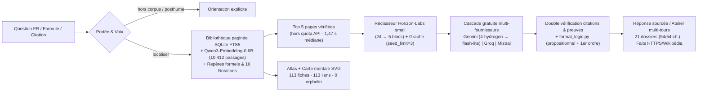

# 🔎 BungeRAG

> Interrogez l’œuvre de Mario Bunge (25 ouvrages, ~8 200 pages) en français.
> Chaque passage renvoie à son édition vérifiée (SHA-256, folio imprimé + page PDF ou section EPUB).
> Si les textes ne suffisent pas, le système le dit explicitement (**« Absent du corpus »** ou **« Passage non retrouvé »**). Et tout est **mesuré**.

**[🚀 Démo en ligne](https://huggingface.co/spaces/alexisgirard/bungerag)** · [📊 Mesures V3](eval/RESULTATS-V3.md) · [🗺️ Feuille de route](FEUILLE-DE-ROUTE.md) · [📚 Couverture du Traité](eval/COUVERTURE-TRAITE.md) · [📓 Journal de bord](JOURNAL.md)

---

## BungeRAG V3/V4 : trois volets reliés, 54/54 chapitres du Traité et Atelier multi-tours

BungeRAG réunit dans un seul site gratuit (CPU Hugging Face Spaces) **trois parcours complémentaires** sur les 25 ouvrages de Mario Bunge (dont les 9 volumes/parties du *Treatise on Basic Philosophy*) :

1. **Rechercher et déplier un argument :** recherche paginée sur toute la bibliothèque (citation exacte, souvenir en français, formule mathématique ou repère formel), affichage de l’édition vérifiée (SHA-256, folio imprimé + page PDF ou section EPUB), distinction des voix citées (Emerson, Wilson, Frege, Mill, Husserl) et dépliage direct de l’argument.
2. **Atlas des concepts & carte mentale interactive :** référentiel versionné (`2026-11-26.20`) de **113 fiches et 113 liens vérifiés** (0 orphelin, 54/54 chapitres du *Traité* couverts), **carte mentale SVG interactive** (zoom/pan, 6 domaines colorés, inspection des nœuds et arêtes sourcées au clic), **lexique filtrable de 16 symboles et notations formelles** (`⟨C, E, S, M⟩`, `M(c)`, `v(p)`, `ℳ = ⟨D, F, I⟩`, etc.), et comparaisons datées entre ouvrages avec lecture éditoriale séparée.
3. **Atelier philosophique & débat multi-tours :** **21 dossiers argumentés couvrant les 54/54 chapitres des 9/9 tomes/parties du *Traité*** + dossiers libres avec **pré-remplissage sourcé et durci SSRF des faits contemporains** (URL HTTPS publique ou notice Wikipédia datée), contestation locale de prémisse (*Suspendre / Remplacer / Rétablir*), **débat philosophique multi-tours** conservant les prémisses suspendues en mémoire active tout en vérifiant chaque citation dans Bunge, **5 formalisations propositionnelles** et **3 preuves vérifiées en logique du premier ordre** avec contre-modèles ([formal_logic.py](src/formal_logic.py)).

### Chiffres clés (26 novembre 2026)

| Volet / Métrique | Résultat vérifié | Référence |
|---|---|---|
| Recherche directe de pages (jeu réservé, 25 q.) | **24/25** au top 5 · **5/5** orientations sans cible · **1,47 s** médiane sur le Space | [RESULTATS-V3.md](eval/RESULTATS-V3.md) |
| Sélection de blocs rédaction (`Horizon-Labs small`, 24 → 5) | **23/25** sur jeu réservé · **13/30** sur jeu historique (vs 10/30 en V2) | [RESULTATS-V3.md](eval/RESULTATS-V3.md) |
| Embeddings (10 412 passages, dense seul) | `Qwen3-Embedding-0.6B` **18/25** (vs EmbeddingGemma 2 : 16/25, Granite : 12/25) | [RESULTATS-V3.md](eval/RESULTATS-V3.md) |
| Renvois du graphe (11 questions multi-prémisses) | **9/11** arguments complets (`seed_limit=3`) contre 2/11 en pages seules | [RESULTATS-V3.md](eval/RESULTATS-V3.md) |
| Référentiel, Atlas, Atelier & Fidélité | **113 fiches / 113 liens**, **16 notations**, **21 dossiers (54/54 chapitres)**, **5+3 preuves**, **8 biais + 22 tours** | [COUVERTURE-TRAITE.md](eval/COUVERTURE-TRAITE.md) |

---

## Architecture



---

## Stack technique (100 % gratuit, choix mesurés sur le corpus)

| Brique | Choix retenu | Justification mesurée |
|---|---|---|
| Extraction PDF / EPUB | `pymupdf4llm` + `ebooklib` + OCR Apple Vision (`ocrmac`) | Markdown structuré, ~35 000 lignes de mobilier retirées, concordance exacte folio/PDF + sommaire EPUB |
| Indexation | SQLite FTS5 (`lecture.sqlite`, `provenance-512.sqlite`) + LanceDB | Zéro serveur, recherche exacte/formule/hybride portable |
| Embeddings | `Qwen/Qwen3-Embedding-0.6B` (local CPU/MPS) | Bat `EmbeddingGemma 2` (16/25, 6/30) et `Granite 311M R2` (12/25, 9/30) avec **18/25** et **9/30** au top 5, hors quota API |
| Reclassement | `Horizon-Labs/multilingual-reranker-small` (141 M, Apache 2.0) | **23/25** sur jeu réservé et **13/30** sur jeu historique ; bat `Horizon base` (10/30 historique et +49 % latence CPU) |
| Génération & secours | Cascade Gemini (`4-hydrogen` → `3.8-flash` → `2.5-flash` → `3.1-flash-lite` → `3.5-flash-lite`) + secours optionnel Groq (`llama-3.3-70b-versatile`) & Mistral (`mistral-small-latest`) | Meilleur modèle en tête avec coupe-circuit (5 min sur `503`/`504`, 30 min sur `429`), bascule automatique multi-fournisseurs si `GROQ_API_KEY` / `MISTRAL_API_KEY` est défini ; repli 100 % local via Ollama (`qwen3.5:9b`) |
| Vérification logique | [workshop.py](src/workshop.py) + [formal_logic.py](src/formal_logic.py) | 5 tables booléennes + 3 preuves en logique du premier ordre sur structures finies avec contre-modèles explicites |
| Faits contemporains | [contemporary.py](src/contemporary.py) | Pré-remplissage par URL HTTPS publique (durci SSRF : blocage IP privées/locales/DNS interne, sans redirection) ou API REST Wikipédia FR/EN |
| Démo & déploiement | Gradio + Hugging Face Spaces (CPU gratuit) + SVG embarqué ([atlas_graph.py](space/atlas_graph.py)) | Carte mentale SVG interactive zéro CDN, dataset privé (jeton read-only distinct), liste blanche stricte (`push_space.py`), quotas atomiques |
| Qualité & CI | `pytest` (108 tests), `ruff`, `compileall`, Gitleaks + 3 audits bloquants | CI verte sans corpus ni SQLite ; `audit_reader`, `audit_workshop` et `audit_fidelity` exigés avant toute publication |

---

## Consulter ou reproduire en local

Le corpus (sous droit d’auteur) **n’est pas distribué** — ni les PDF, ni l’index textuel. Le pipeline reconstruit tout localement depuis vos propres exemplaires :

```bash
git clone https://github.com/alexisgirard-it/bungerag && cd bungerag
python3.12 -m venv .venv && .venv/bin/pip install -r requirements.txt

# 1. Placer vos PDF/EPUB dans corpus/ (voir manifest.csv) et vos clés dans .env
# 2. Construire l’index, la concordance et la base de lecture paginée
.venv/bin/python src/build_index.py --extract --size 512
.venv/bin/python src/build_provenance.py 512
.venv/bin/python src/build_library.py

# 3. Lancer l’interface V3 en local (les cartes ouvrent directement les PDF à la bonne page)
RAG_PROFILE=public_v3 .venv/bin/python space/app.py
```

- **Mode 100 % local (sans API externe) :** installez [Ollama](https://ollama.com), lancez `ollama pull qwen3.5:9b`, puis démarrez avec `LLM_BACKEND=ollama RAG_PROFILE=public_v3 .venv/bin/python space/app.py`.
- **Profils versionnés :** `public_v3` est le profil actif du Space (`k_candidates=24`) ; `public_v2` et `public_v1` restent figés dans [config.py](src/config.py) pour la reproductibilité historique.

---

## Leçons de terrain

1. **Les points sont d’abord dans les données et les éditions :** purger 837 chunks d’annexes a donné +25 pts de rappel en V1 ; lier chaque citation à son SHA-256 d’édition et sa concordance PDF/EPUB a éliminé les pages fantômes.
2. **Ne jamais faire confiance aux quotas théoriques ni aux benchmarks génériques :** sur le corpus réel de Bunge, `Qwen3-Embedding-0.6B` bat `EmbeddingGemma 2` et `Granite R2`, `Horizon small` bat `Horizon base`, et le palier gratuit Gemini exige une cascade avec coupe-circuit par modèle.
3. **Les tokens de réflexion tronquent silencieusement le JSON :** borner explicitement `thinking_budget=512` (ajouté à `max_output_tokens`) sur les modèles pensants a fait passer `gemini-2.5-flash` d’échecs JSON à 100 % de réussite en 13 s.
4. **Un graphe vérifié bat l’élargissement aveugle aux pages voisines :** à budget strict de 5 pages, ajouter des pages voisines fait perdre 4 questions réservées (24/25 → 20/25), alors que l’expansion par graphe (`seed_limit=3`) atteint 9/11 arguments complets sans dégrader la recherche.
5. **La fiabilité du gratuit se construit :** séparation stricte recherche hors quota vs génération API, vérifications bloquantes avant publication, double passe de contrôle des citations et tests de fidélité sur formulations orientées.

---

## Limites assumées

- **Quotas gratuits de génération :** sur le Space public, `gemini-4-hydrogen` et `gemini-2.5-flash` atteignent vite leur quota journalier gratuit (`429`) ou des pics `503` ; le coupe-circuit bascule vers `gemini-3.1-flash-lite` puis automatiquement vers Groq (`GROQ_API_KEY`) ou Mistral (`MISTRAL_API_KEY`) s’ils sont configurés dans les secrets du Space. La recherche paginée, l’Atlas interactif et les 21 dossiers curatés restent disponibles sans quota API.
- **Étendue du corpus :** 25 ouvrages majeurs sont indexés (dont 100 % des 54 chapitres du *Traité*), mais plusieurs œuvres tardives ou monographies spécialisées de Bunge restent à ajouter selon la disponibilité des exemplaires.
- **Portée des preuves formelles :** les 3 vérificateurs en logique du premier ordre ([formal_logic.py](src/formal_logic.py)) procèdent par énumération exhaustive de structures finies (et exhibent des contre-modèles concrets), ce qui couvre exactement les axiomes ciblés sans prétendre à un assistant de preuve général d’ordre supérieur.
- **Archive V1 / V2 :** les mesures historiques pré-V3 (run legacy RAGAS 0.4.3 à `0,935` de faithfulness, jugement indépendant Cerebras et validation humaine) sont conservées séparément dans [eval/RESULTS.md](eval/RESULTS.md), [eval/VALIDATION-HUMAINE.md](eval/VALIDATION-HUMAINE.md), [eval/RESULTATS-V2.md](eval/RESULTATS-V2.md) et [JOURNAL.md](JOURNAL.md).

---

## Structure

```
src/                 17 modules runtime du Space + scripts hors-ligne (voir src/README.md)
eval/                jeux figés (historique, réservé, liaisons, fidélité), mesures V2/V3 et couverture
space/               application Gradio (Recherche, Atlas SVG, Atelier multi-tours) et tests d’interface
tests/               tests unitaires sans corpus, modèle lourd ni API (compatibles CI)
manifest.csv         liste curée des 25 ouvrages du corpus et exclusions justifiées
FEUILLE-DE-ROUTE.md  mémoire versionnée des 3 volets et journal des décisions
PLAN-RECHERCHE.md    plan détaillé du volet 1
JOURNAL.md           journal de bord historique (V1)
```

## Licence

Code sous [MIT](LICENSE). Les œuvres de Mario Bunge restent la propriété de leurs ayants droit. Le dépôt ne distribue ni PDF, ni corpus intégral, ni index textuel ; les fichiers d’évaluation contiennent seulement de courtes citations sourcées nécessaires à la vérification des références.
